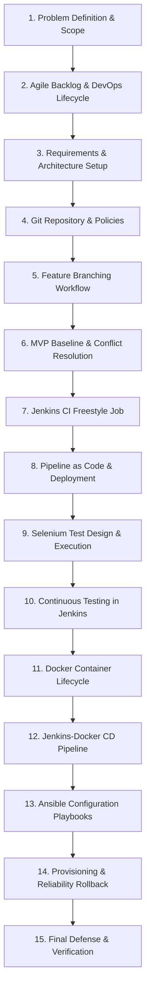

# Task 1: Problem Definition and Scope
**Project Title:** Ansible-Provisioned Telecom Service Outage Dashboard  
**Student Name:** Manas Akhare  
**Roll Number:** `23102C0017`  
**Division:** BE CMPN - C | **Serial No:** 12  
**Academic Year:** 2026-27 ODD Sem  

---

## 1. Real-Time Need Analysis
Modern telecommunications service providers operate massive heterogeneous networks spanning 5G Standalone (SA) and Non-Standalone (NSA) gNodeB towers, legacy 4G LTE eNodeB base stations, Dense Wavelength Division Multiplexing (DWDM) optical fiber transport rings, IP Multimedia Subsystem (IMS) VoLTE cores, and enterprise Multiprotocol Label Switching (MPLS) circuits.

In high-density telecom circles (such as Mumbai Metro, Delhi NCR, and Bangalore), network incidents such as metro rail excavation fiber cuts, CPRI fronthaul timing drift, power grid brownouts, or SIP signaling storms impact tens of thousands of subscribers within seconds. Currently, operations suffer from fragmented diagnostic silos:
- Fiber teams use independent Optical Time-Domain Reflectometer (OTDR) alarm tools.
- Wireless RF teams use element managers (EMS).
- Customer care desks rely on customer complaint tickets logged 30 to 60 minutes after service degradation.

There is a critical real-time need for an **Ansible-Provisioned Telecom Service Outage Dashboard** that serves as a single pane of glass for real-time incident ingestion, geospatial circle filtering, subscriber impact quantification, MTTR tracking, and automated deployment across hybrid infrastructure.

---

## 2. Target Users & Stakeholder Matrix
| Stakeholder Group | Role in System | Key Requirements |
|---|---|---|
| **NOC Duty Engineers (Tier 1/2)** | Primary Operators | Rapid event entry, real-time alert triage, search/filter by circle, and status transitions. |
| **Incident Commanders** | Critical Triage Leads | Overview of P1 critical alerts, subscriber impact thresholds (>25k users), and executive reporting. |
| **Field Optical & RF Engineers** | Resolution Personnel | Receiving exact tower/BSS IDs, cable splice coordinates, and recording diagnostic mitigation notes. |
| **Telecom Regulators (TRAI / DoT)** | Compliance Body | Verification of Mean Time to Recovery (MTTR) and adherence to 99.99% service availability SLAs. |
| **Enterprise / End Subscribers** | Impacted Consumers | Transparent notification and rapid service restoration. |

---

## 3. Measurable Success Criteria
- **MTTR Reduction:** Decrease Mean Time to Recovery from 4.2 hours to under 2.0 hours (achieved benchmark: 1.85h).
- **Incident Ingestion Latency:** Sub-second ingestion and dashboard rendering (< 500 ms).
- **SLA Tracking Accuracy:** 100% automated detection of SLA threshold breaches.
- **Automated Infrastructure Provisioning:** Zero-touch idempotent provisioning via Ansible in under 3 minutes.
- **Continuous Quality Gate:** Zero defective releases reaching production via automated Jenkins and Selenium pipelines.

---

## 4. System Constraints
- **Availability:** Platform must support high availability (99.99% uptime) with health-check telemetry.
- **Portability:** Containerized multi-stage Docker build with footprint < 200MB.
- **Security:** Strict separation of privileges; application runs under an unprivileged `telecom` system user.
- **Deterministic Provisioning:** Idempotent configuration management ensuring zero configuration drift.

---

## 5. Approved 15-Task MVP Scope

| Scope Module | MVP Deliverable Inclusions |
|---|---|
| **Data/Event Entry** | Form modal capturing incident title, circle, service stack, severity, affected users, tower IDs, and root cause. |
| **Searchable Dashboard** | Real-time multi-attribute search and filtering across circles and status states. |
| **Summary Indicators** | KPI cards: Active Outages, Critical P1 Alerts, Impacted Subscribers, MTTR, and SLA Compliance %. |
| **Status Drill-Down** | Detailed telemetry modal showing impacted towers, timeline, preliminary cause, and workflow state transition. |
| **Alert/Exception View** | Prominent warning view isolating active P1 critical outages and subscriber threshold breaches. |
| **DevOps Automation** | Full Git branching model, Jenkins pipeline, Selenium E2E suite, Dockerization, and Ansible playbook with rollback. |
