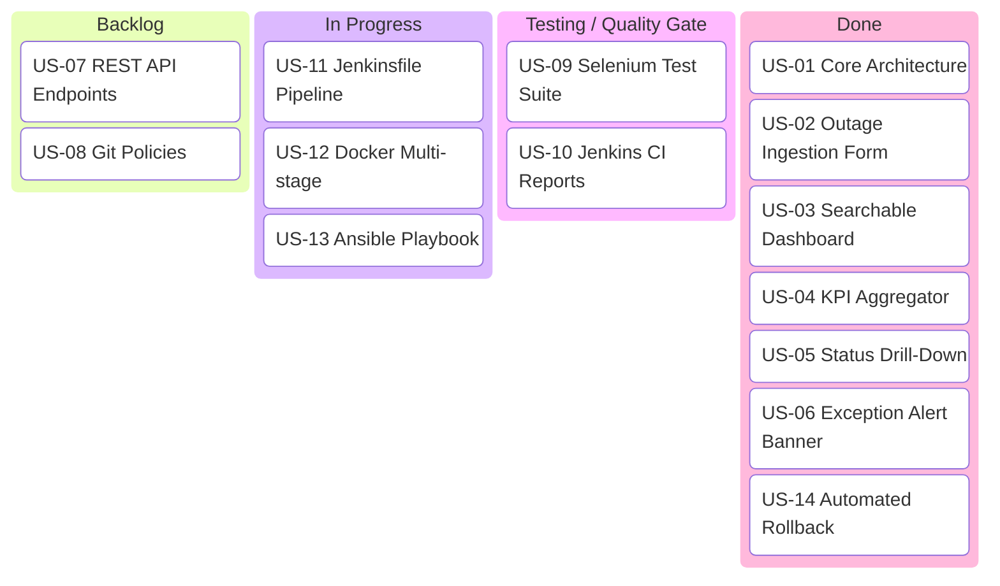

# Task 2: Agile Planning and DevOps Workflow
**Project Title:** Ansible-Provisioned Telecom Service Outage Dashboard  
**Student Name:** Manas Akhare  
**Roll Number:** `23102C0017`  
**Division:** BE CMPN - C | **Serial No:** 12  

---

## 1. User Stories and Acceptance Criteria (Given / When / Then)

### Story 1: Outage Ingestion & Event Logging (NOC Operator)
- **As a** NOC Engineer,  
- **I want to** quickly submit a new telecom outage record with affected circle, cellular towers, and estimated subscribers,  
- **So that** incident dispatch can alert field teams and begin SLA countdowns immediately.
- **Acceptance Criteria:**
  - *Given* a valid incident title, circle, severity, and impacted subscriber count,
  - *When* the engineer clicks "Submit Outage to NOC Queue",
  - *Then* the system assigns a unique sequential ID (e.g. `OUT-1006`), commits the record, updates the active count, and presents a confirmation alert banner.

### Story 2: Live Search & Circle Filtering (Incident Commander)
- **As an** Incident Commander,  
- **I want to** filter the dashboard by telecom circle (e.g., "Mumbai Metro") or severity (e.g., "CRITICAL"),  
- **So that** I can isolate regional disaster events without manual spreadsheet searching.
- **Acceptance Criteria:**
  - *Given* an active registry of network disruptions,
  - *When* typing "BKC" in the search bar or choosing "Mumbai Metro" from the dropdown,
  - *Then* the table immediately renders only matching rows and updates the visible incident counter.

### Story 3: Critical Exception Alerting (Executive Operations)
- **As an** Executive Operations Lead,  
- **I want to** see an isolated banner of all active P1 outages exceeding 25,000 subscribers,  
- **So that** high-impact carrier outages are escalated before SLA penalties apply.
- **Acceptance Criteria:**
  - *Given* any outage with severity `CRITICAL` and status not equal to `RESOLVED`,
  - *When* accessing the dashboard,
  - *Then* the system prominently displays the outage in the top Critical Exception Alert queue.

---

## 2. Product Backlog & MoSCoW Prioritization
| ID | User Story / Work Item | MoSCoW Priority | Story Points | Sprint |
|---|---|---|---|---|
| **US-01** | Core In-Memory Domain Model & Service CRUD Architecture | Must Have | 5 | Sprint 1 |
| **US-02** | Data/Event Entry UI Form Modal with Spring Validation | Must Have | 5 | Sprint 1 |
| **US-03** | Searchable Dashboard with Live Client-Side JS Filtering | Must Have | 3 | Sprint 1 |
| **US-04** | KPI Summary Metrics Engine (Active Outages, MTTR, SLA %) | Must Have | 3 | Sprint 1 |
| **US-05** | Status Drill-Down Modal with Tower Diagnostics & State Transitions | Must Have | 5 | Sprint 2 |
| **US-06** | Critical Exception Alert Section for P1 Breaches | Must Have | 3 | Sprint 2 |
| **US-07** | REST API Endpoints (`/api/outages`, `/api/health`, `/api/metrics`) | Should Have | 3 | Sprint 2 |
| **US-08** | Git Feature Branching, PR Workflow & Conflict Resolution | Must Have | 5 | Sprint 2 |
| **US-09** | Selenium WebDriver End-to-End Headless Test Suite | Must Have | 8 | Sprint 2 |
| **US-10** | Jenkins Continuous Integration Job with Test Reporting | Must Have | 5 | Sprint 3 |
| **US-11** | Jenkinsfile Declarative Pipeline as Code | Must Have | 8 | Sprint 3 |
| **US-12** | Multi-Stage Hardened Dockerfile Container Build | Must Have | 5 | Sprint 3 |
| **US-13** | Ansible Playbook for Ubuntu Target Node & Nginx Proxy | Must Have | 8 | Sprint 3 |
| **US-14** | Automated Idempotency & Rollback Recovery Script | Must Have | 5 | Sprint 3 |

---

## 3. Sprint Plan & Kanban Board Breakdown

- **Sprint 1 (Foundations & Core UX):** US-01, US-02, US-03, US-04. Delivered working core UI with event entry and search.
- **Sprint 2 (Telemetry, Diagnostics & Testing):** US-05, US-06, US-07, US-08, US-09. Completed drill-down, alerts, REST API, Git PRs, and Selenium test suite.
- **Sprint 3 (DevOps Automation & Reliability):** US-10, US-11, US-12, US-13, US-14. Configured Jenkins pipeline, Docker containerization, Ansible provisioning, and automated rollback.

---

## 4. Definition of Done (DoD)
A story or task is considered **Done** only when:
1. **Code Quality:** Written in standard Java 17 / Spring Boot conventions with zero compilation warnings.
2. **Automated Testing:** 100% of JUnit 5 unit tests, MockMvc integration tests, and Selenium E2E user journeys pass cleanly (`mvn clean test`).
3. **Version Control:** Committed with Conventional Commits, reviewed via Pull Request, merged into `develop` or `main`, and conflict-free.
4. **Containerization:** Multi-stage Docker image builds with a clean exit code and passes healthcheck.
5. **Configuration Management:** Ansible playbook executes idempotently (0 failed tasks, 0 changed on rerun).
6. **Documentation:** Dedicated task report generated with architectural diagrams and execution evidence.

---

## 5. DevOps Lifecycle Architecture Diagram

```mermaid
flowchart LR
    subgraph Dev ["Development"]
        Plan["1. Plan & Backlog<br/>(Jira / Kanban)"] --> Code["2. Code & Branch<br/>(Git / Java 17)"]
        Code --> LocalTest["3. Local Test<br/>(Maven & Selenium)"]
    end

    subgraph CI ["Continuous Integration"]
        LocalTest --> Push["4. Push to GitHub<br/>(PR Review)"]
        Push --> JenkinsCI["5. Jenkins CI Build<br/>(Unit & Selenium)"]
        JenkinsCI --> Artifact["6. Archive Artifact<br/>(Spring JAR & Reports)"]
    end

    subgraph CD ["Continuous Delivery"]
        Artifact --> DockerBuild["7. Docker Build<br/>(Versioned Image)"]
        DockerBuild --> Ansible["8. Ansible Provision<br/>(Target Nodes & Nginx)"]
        Ansible --> HealthCheck["9. Health Verification<br/>(HTTP 200 UP)"]
    end

    subgraph Ops ["Operations & Feedback"]
        HealthCheck --> Monitor["10. Monitor & Telemetry<br/>(NOC Outage Dashboard)"]
        Monitor --> Rollback{"Fault Detected?"}
        Rollback -- Yes --> RollbackPlaybook["11. Ansible Rollback<br/>(rollback.yml)"]
        Rollback -- No --> Feedback["12. Feedback to Backlog"]
        RollbackPlaybook --> Feedback
    end
```

