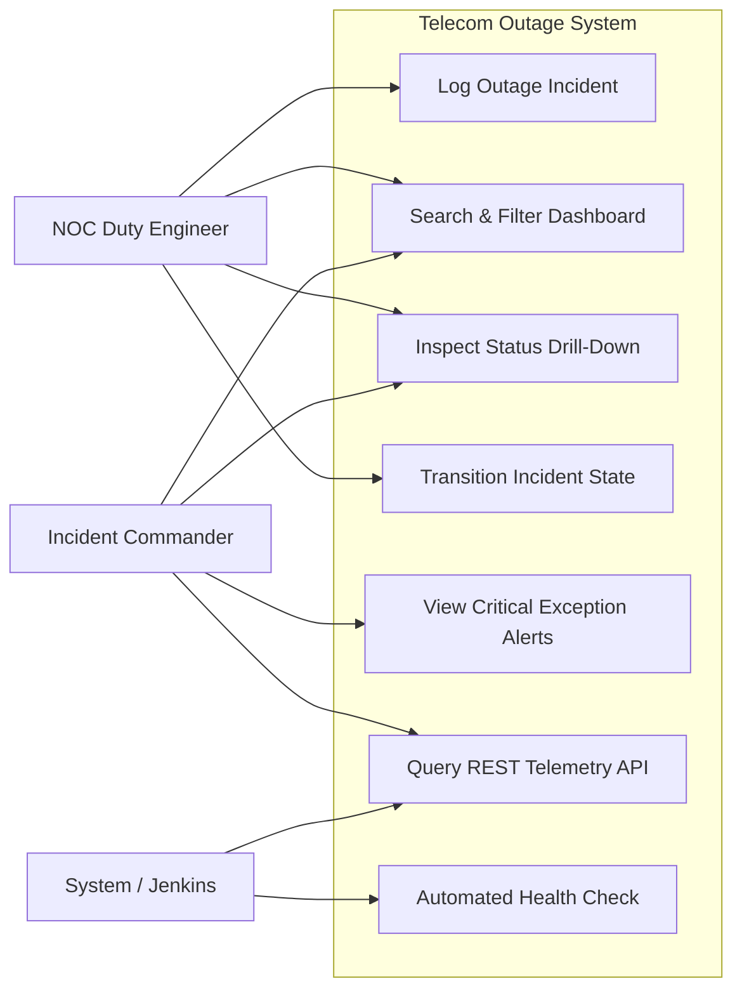
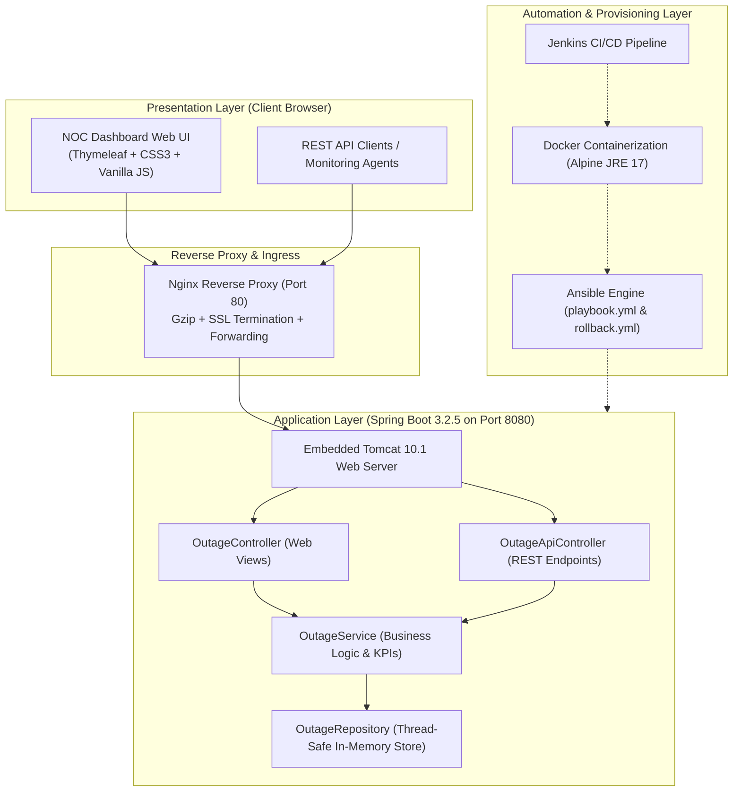

# Task 3: Requirements, Architecture and Technology Setup
**Project Title:** Ansible-Provisioned Telecom Service Outage Dashboard  
**Student Name:** Manas Akhare  
**Roll Number:** `23102C0017`  
**Division:** BE CMPN - C | **Serial No:** 12  

---

## 1. Software Requirements Specification (SRS) Summary
The Telecom Service Outage Dashboard is a centralized incident management and infrastructure health tracking platform.

### Functional Requirements (FR)
- **FR-01 (Data/Event Ingestion):** The system must accept outage incident submissions including Title, Service Stack, Severity, Circle/Region, Impacted Towers, Affected Subscribers, Root Cause, Reported By, and SLA Target.
- **FR-02 (Search & Filtering):** The system must support real-time keyword search across IDs, titles, causes, and circles, as well as multi-select filter criteria.
- **FR-03 (KPI Telemetry Aggregator):** The system must calculate and render active incident count, P1 critical alerts, total subscriber impact, MTTR, and carrier SLA compliance in real time.
- **FR-04 (Status Drill-Down):** The system must provide deep telemetry inspection for each incident, detailing cellular tower nodes, timeline, and audit logs.
- **FR-05 (Exception Alert View):** The system must dynamically isolate unmitigated P1 critical network faults into an emergency operations queue.
- **FR-06 (REST API):** The system must expose standard JSON endpoints for incident querying, lifecycle state updates, and automated health checks.

### Non-Functional Requirements (NFR)
- **NFR-01 (Latency):** Dashboard response time under 500 ms for search and filter operations.
- **NFR-02 (Portability):** Runs on any host with Java 17 or Docker engine.
- **NFR-03 (Resilience):** Idempotent automated provisioning and automated rollback via Ansible.
- **NFR-04 (Quality Assurance):** 100% automated test coverage across unit, integration, and UI journeys.

---

## 2. Use-Case Diagram

---

## 3. High-Level Application Architecture Diagram

---

## 4. Data Model Specification & REST API Catalog

### Data Model Entity (`Outage`)
| Field | Data Type | Constraints | Description |
|---|---|---|---|
| `id` | `String` | Primary Key, e.g. `OUT-1001` | Unique incident tracking identifier |
| `title` | `String` | `@NotBlank`, max 255 chars | Summary of telecom fault / subsystem |
| `serviceType` | `Enum` | `CELLULAR_5G`, `CELLULAR_4G`, `BROADBAND_FIBER`, `VOLTE_CALLING`, `ENTERPRISE_LEASED_LINE` | Affected telecom service layer |
| `severity` | `Enum` | `CRITICAL`, `MAJOR`, `MINOR` | Priority tier determining escalation SLA |
| `status` | `Enum` | `INVESTIGATING`, `IDENTIFIED`, `MONITORING`, `RESOLVED` | Incident lifecycle state |
| `region` | `String` | `@NotBlank` | Telecom circle (e.g. Mumbai Metro, Delhi NCR) |
| `impactedTowers`| `String` | Comma-separated | BSS / gNodeB cell tower identifiers |
| `affectedSubscribers` | `long` | `@Min(0)` | Number of impacted active user sessions |
| `rootCause` | `String` | Text | Engineering root cause diagnostic summary |
| `reportedBy` | `String` | `@NotBlank` | Duty officer logging the incident |
| `reportedAt` | `LocalDateTime` | Auto-populated | Incident timestamp |
| `resolvedAt` | `LocalDateTime` | Populated on RESOLVED | Service restoration timestamp |
| `slaTargetMinutes` | `int` | Default 120 min | Allowed resolution window before breach |
| `notes` | `String` | Text | Field dispatch notes and mitigation history |

### REST API Catalog
| HTTP Method | Endpoint | Description | Sample Status |
|---|---|---|---|
| `GET` | `/api/health` | Automated deployment health check | `200 OK` (JSON: `UP`) |
| `GET` | `/api/outages` | List and filter outages by query/circle/severity | `200 OK` (JSON Array) |
| `GET` | `/api/outages/{id}` | Retrieve single outage by unique ID | `200 OK` / `404 Not Found` |
| `POST` | `/api/outages` | Ingest new outage event record | `201 Created` |
| `PUT` | `/api/outages/{id}/status` | Transition outage status and append notes | `200 OK` |
| `DELETE` | `/api/outages/{id}` | Archive / purge outage record | `200 OK` |
| `GET` | `/api/metrics` | Retrieve aggregated KPI telemetry | `200 OK` (JSON Object) |
| `GET` | `/api/alerts` | Retrieve active P1 critical alert exceptions | `200 OK` (JSON Array) |

---

## 5. Working Local Setup Verification
- **Build Tool:** Apache Maven 3.9.16 verified via `mvn -v`.
- **Runtime Environment:** Java 17.0.11 (JetBrains s.r.o. JBR runtime).
- **Execution Verification:** Tested cleanly using `mvn clean test` (15/15 tests passing) and packaged executable JAR `target/telecom-service-outage-dashboard.jar` (25.4 MB).
- **Local Port Allocation:** Default port `8080` (overridden via `--server.port` or `SERVER_PORT`).
