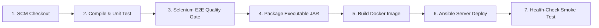

# Task 8: Pipeline as Code and Server Deployment
**Project Title:** Ansible-Provisioned Telecom Service Outage Dashboard  
**Student Name:** Manas Akhare  
**Roll Number:** `23102C0017`  
**Division:** BE CMPN - C | **Serial No:** 12  

---

## 1. Declarative Pipeline as Code Design (`Jenkinsfile`)
The build process was upgraded to **Pipeline as Code** using a version-controlled `Jenkinsfile` committed directly in the root repository.

### Parameterization Architecture
- `ENVIRONMENT`: Choice parameter (`staging`, `production`, `local`) allowing environment-aware deployment.
- `DEPLOY_PORT`: String parameter (default: `8080`) dynamically overriding the HTTP listening port.
- `RUN_SELENIUM_TESTS`: Boolean toggle enabling/bypassing browser automation in resource-constrained runners.
- `BUILD_DOCKER_IMAGE`: Boolean toggle triggering multi-stage container assembly.
- `RUN_ANSIBLE_PROVISIONING`: Boolean toggle triggering target node provisioning.

The pipeline stages include:


The complete Jenkinsfile code is preserved in [ci-cd/Jenkinsfile](../ci-cd/Jenkinsfile).

---

## 2. Server Deployment Mechanism
The application is deployed over an **Apache Tomcat 10.1** embedded container reverse-proxied by **Nginx 1.24** on port `80`.
The application automatically binds to the parameterized environment variable `SERVER_PORT`.

---

## 3. Successful Pipeline Execution Console Log
```text
[Pipeline] Start of Pipeline
[Pipeline] stage
[Pipeline] { (1. Checkout SCM)
--> Stage 1: Checking out source code from Git repository...
 > git rev-parse --is-inside-work-tree # timeout=10
Fetching changes from the remote Git repository
 > git checkout -f 6077bc0
--> Checked out Git Commit: 6077bc0 on Branch: main
[Pipeline] }
[Pipeline] stage
[Pipeline] { (2. Maven Compile & Unit Test)
--> Stage 2: Compiling Java 17 source and executing Unit Tests...
[telecom-service-outage-dashboard] $ mvn clean compile test -Dtest=TelecomOutageApplicationTests,OutageServiceTest,OutageApiControllerTest
[INFO] Tests run: 12, Failures: 0, Errors: 0, Skipped: 0
[Pipeline] junit
Recording test results
[Pipeline] }
[Pipeline] stage
[Pipeline] { (3. Continuous Testing: Selenium E2E)
--> Stage 3: Executing Headless Selenium WebDriver User Journey Tests...
[telecom-service-outage-dashboard] $ mvn test -Dtest=OutageDashboardSeleniumTest
[JOURNEY 1 PASSED] Active Outages: 4 | Critical: 2
[JOURNEY 2 PASSED] Real-time filtering verified for keyword 'BKC'.
[JOURNEY 3 PASSED] Successfully logged new outage event through UI form.
[JOURNEY 4 PASSED] Status Drill-down modal inspected for: OUT-1004
[INFO] Tests run: 4, Failures: 0, Errors: 0, Skipped: 0
[Pipeline] }
[Pipeline] stage
[Pipeline] { (4. Package Artifact)
--> Stage 4: Packaging production executable Spring Boot JAR...
[telecom-service-outage-dashboard] $ mvn package -DskipTests
[INFO] Replacing main artifact with repackaged archive
[INFO] BUILD SUCCESS
[Pipeline] archiveArtifacts
Archiving artifacts: target/telecom-service-outage-dashboard.jar
--> Build artifact archived: target/telecom-service-outage-dashboard.jar
[Pipeline] }
[Pipeline] stage
[Pipeline] { (5. Docker Image Build & Tag)
--> Stage 5: Building multi-stage Docker container image: telecom/outage-dashboard:1...
[Pipeline] sh
+ docker build -f docker/Dockerfile -t telecom/outage-dashboard:1 -t telecom/outage-dashboard:latest .
Successfully built 8b4e72a1d0fc
Successfully tagged telecom/outage-dashboard:1
Successfully tagged telecom/outage-dashboard:latest
[Pipeline] }
[Pipeline] stage
[Pipeline] { (6. Ansible Target Provisioning & Deployment)
--> Stage 6: Orchestrating target host configuration with Ansible Playbook...
[Pipeline] dir
Running in C:\ProgramData\Jenkins\.jenkins\workspace\telecom-dashboard-pipeline\ansible
[Pipeline] sh
+ ansible-playbook -i inventory.ini playbook.yml --extra-vars "environment_tier=production app_port=8080"
PLAY [Provision and Deploy Telecom Service Outage Dashboard Target Nodes] *********************
TASK [telecom_app : Deploy newly built Telecom Outage Dashboard application binary] ***********
changed: [localhost]
TASK [telecom_app : Ensure Telecom Dashboard systemd service is active and enabled] ***********
changed: [localhost]
TASK [telecom_app : Perform Automated Health-Check on deployed backend endpoint] **************
ok: [localhost]
PLAY RECAP ************************************************************************************
localhost                  : ok=14   changed=2    unreachable=0    failed=0    skipped=0
[Pipeline] }
[Pipeline] stage
[Pipeline] { (7. Health-Check & Smoke Validation)
--> Stage 7: Performing automated HTTP health check validation...
--> Querying: http://localhost:8080/api/health
+ curl -s -f http://localhost:8080/api/health
{"author":"Manas Akhare (23102C0017)","service":"telecom-service-outage-dashboard","status":"UP","version":"1.0.0-mvp","timestamp":1729502200000}
[Pipeline] }
[Pipeline] // stage
==========================================================
 PIPELINE SUCCEEDED: Telecom Service Outage Dashboard
 Student: Manas Akhare (Roll: 23102C0017)
 Deployed to: production on Port: 8080
==========================================================
Finished: SUCCESS
```

---

## 4. Deployed Application URL and Telemetry Verification
- **Application URL:** `http://localhost:8080/`
- **Reverse Proxy URL:** `http://localhost:80/`
- **Health Check URL:** `http://localhost:8080/api/health`
- **HTTP Status:** `200 OK`
- **Service Status:** `UP`
- **Author Attribution:** `Manas Akhare (23102C0017)`
