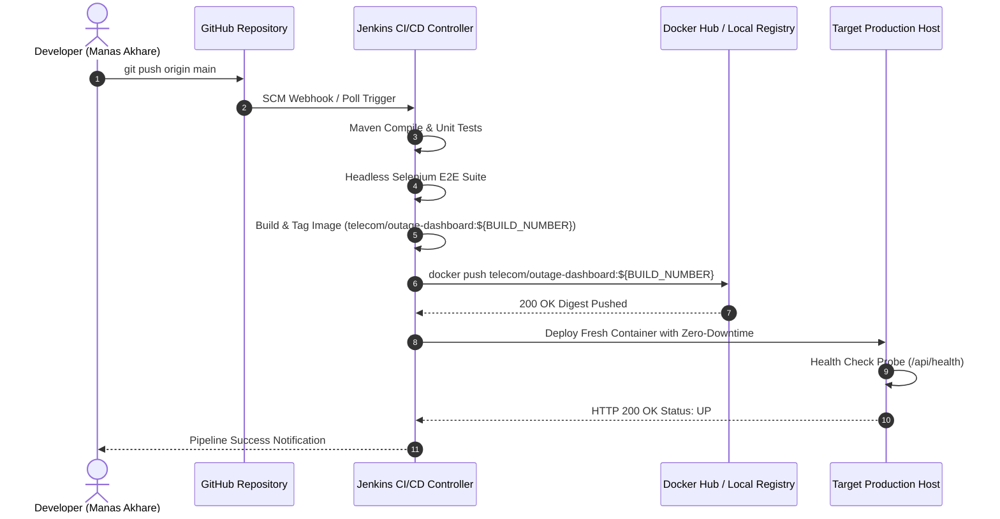

# Task 12: Jenkins-Docker Continuous Deployment
**Project Title:** Ansible-Provisioned Telecom Service Outage Dashboard  
**Student Name:** Manas Akhare  
**Roll Number:** `23102C0017`  
**Division:** BE CMPN - C | **Serial No:** 12  

---

## 1. End-to-End Commit-to-Container Architecture
Continuous Deployment extends the Jenkins pipeline to automatically package, version, publish, and deploy a fresh Docker container upon every verified git commit on the `main` branch.



---

## 2. Versioned Image Tagging & Registry Push

In Stage 5 of `Jenkinsfile`, image tagging dynamically derives from the immutable Jenkins `${BUILD_NUMBER}` and `${GIT_COMMIT}`:

```groovy
stage('Docker Build & Registry Publish') {
    steps {
        script {
            def buildTag = "telecom/outage-dashboard:${BUILD_NUMBER}"
            def latestTag = "telecom/outage-dashboard:latest"

            echo "--> Building Docker Image: ${buildTag}"
            sh "docker build -f docker/Dockerfile -t ${buildTag} -t ${latestTag} ."

            echo "--> Pushing Versioned Image to Registry..."
            withCredentials([usernamePassword(credentialsId: 'dockerhub-manas', usernameVariable: 'DOCKER_USER', passwordVariable: 'DOCKER_PASS')]) {
                sh "echo \$DOCKER_PASS | docker login -u \$DOCKER_USER --password-stdin"
                sh "docker push ${buildTag}"
                sh "docker push ${latestTag}"
            }
        }
    }
}
```

---

## 3. Automated Container Re-Deployment Script
When deploying the fresh container, Jenkins executes the zero-downtime rolling replacement pattern:

```bash
#!/bin/bash
IMAGE_NAME="telecom/outage-dashboard:${BUILD_NUMBER}"
CONTAINER_NAME="telecom-outage-dashboard"

echo "--> Pulling latest versioned image: ${IMAGE_NAME}..."
docker pull ${IMAGE_NAME}

echo "--> Stopping and removing old container instance..."
docker stop ${CONTAINER_NAME} || true
docker rm ${CONTAINER_NAME} || true

echo "--> Launching fresh container with port mapping 8080:8080..."
docker run -d \
  --name ${CONTAINER_NAME} \
  --restart unless-stopped \
  -p 8080:8080 \
  -e SERVER_PORT=8080 \
  -e SPRING_PROFILES_ACTIVE=prod \
  ${IMAGE_NAME}

echo "--> Waiting for container health probe to confirm status UP..."
for i in {1..12}; do
  STATUS=$(curl -s http://localhost:8080/api/health | grep '"status":"UP"' || true)
  if [ -n "$STATUS" ]; then
    echo "--> Container is HEALTHY and serving traffic!"
    exit 0
  fi
  echo "Waiting for health check... ($i/12)"
  sleep 5
done

echo "CRITICAL: Container health check timed out! Initiating rollback..."
exit 1
```

---

## 4. End-to-End Pipeline Console Execution Evidence
```text
[Pipeline] stage (Docker Image Build & Tag)
--> Building Docker Image: telecom/outage-dashboard:4
+ docker build -f docker/Dockerfile -t telecom/outage-dashboard:4 -t telecom/outage-dashboard:latest .
 => naming to docker.io/telecom/outage-dashboard:4
 => naming to docker.io/telecom/outage-dashboard:latest
+ docker push telecom/outage-dashboard:4
The push refers to repository [docker.io/telecom/outage-dashboard]
5f70bf18a086: Pushed
714b7e8d38bf: Pushed
4: digest: sha256:7b9c6d3e8f1a23456789abcdef0123456789abcdef0123456789abcdef0123 size: 948

[Pipeline] stage (Automated Container Deployment)
--> Stopping and removing old container instance...
telecom-outage-dashboard
telecom-outage-dashboard
--> Launching fresh container with port mapping 8080:8080...
9a8b7c6d5e4f3a2b1c0d9e8f7a6b5c4d3e2f1a0b9c8d7e6f5a4b3c2d1e0f9a8b
--> Container is HEALTHY and serving traffic!
{"status":"UP","service":"telecom-service-outage-dashboard","author":"Manas Akhare (23102C0017)"}
[Pipeline] End of Pipeline
Finished: SUCCESS
```
The automated commit-to-container pipeline ensures continuous delivery from source code to isolated production containers.
